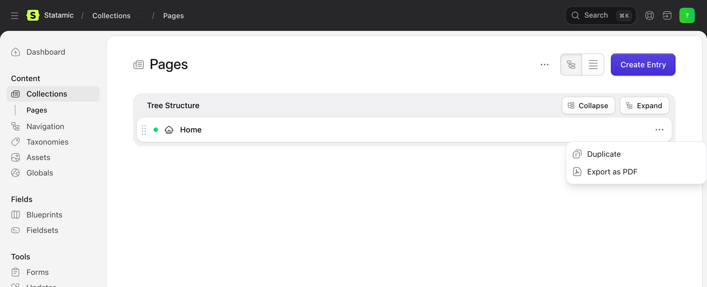
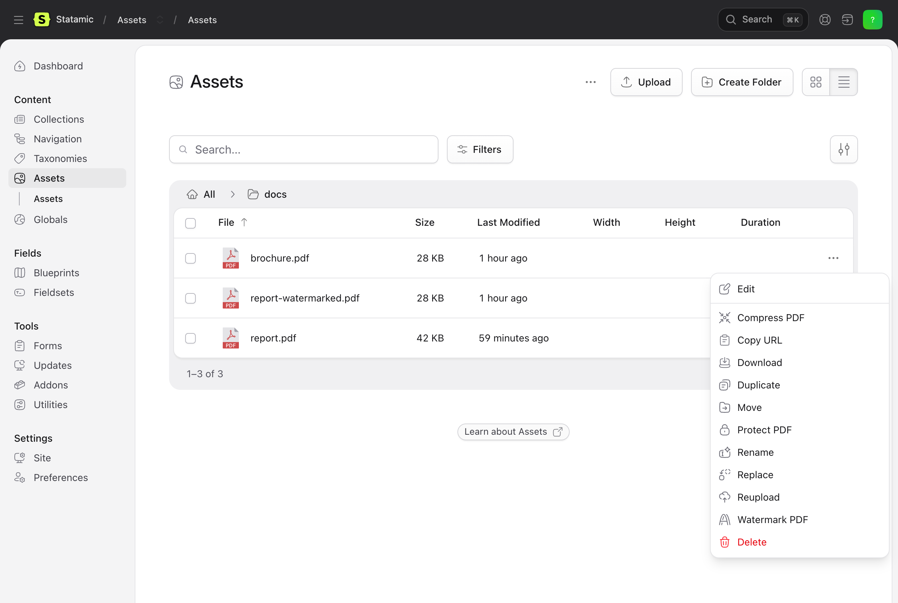
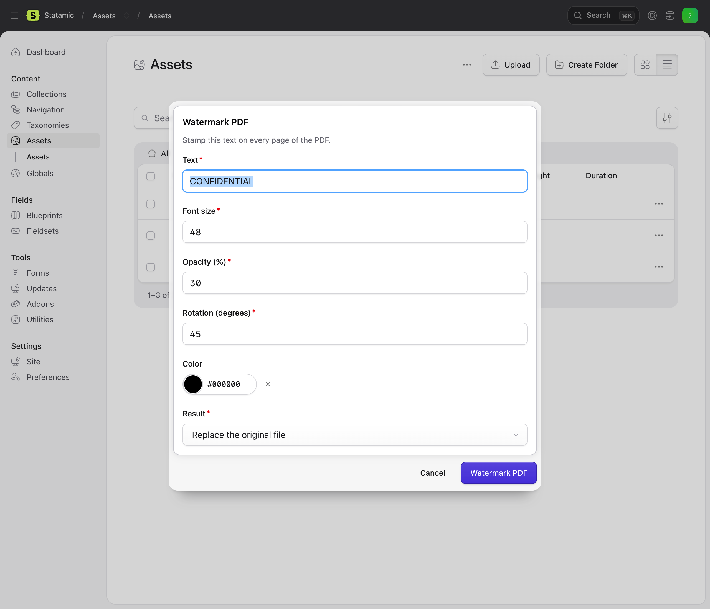

# PDFGate for Statamic

Export entries as PDF and compress, watermark or protect PDF assets without leaving the Statamic Control Panel, powered by the [PDFGate PDF API](https://pdfgate.com/api).

[](https://github.com/pdfgate/statamic-pdfgate/actions/workflows/ci.yml)
[](https://packagist.org/packages/pdfgate/statamic)
[](LICENSE)

Editors get four new actions in the places they already work, and templates get one tag:

- **Export as PDF** in every collection. Pick an entry and download it as a PDF, or pick several and download a zip.
- **Compress PDF**, **Watermark PDF** and **Protect PDF** in every asset container. Each one replaces the file in place or saves a new file next to it.
- `{{ pdfgate:download_url }}` in Antlers gives visitors a "Download as PDF" link for the current page.

Rendering and processing happen on PDFGate's servers. Your site needs no headless browser, no Ghostscript and no PDF library, and it works on any host, including shared hosting and Statamic Cloud-style setups where you cannot install binaries.



## Requirements

- Statamic 5 or 6
- PHP 8.2 or newer with `ext-curl` and `ext-json`
- A [PDFGate](https://pdfgate.com) account and API key

## Installation

```bash
composer require pdfgate/statamic
```

Create an API key in the [PDFGate dashboard](https://dashboard.pdfgate.com) and add it to your site's `.env`:

```dotenv
PDFGATE_API_KEY=live_your_api_key
```

Keys that start with `live_` call the production API, keys that start with `test_` call the sandbox API. Sandbox requests are meant for testing and are not charged on a paid PDFGate plan.

The actions appear in the Control Panel as soon as the key is set, for users who can view entries and edit assets. No further setup is needed.

## Export entries as PDF

Open a collection, pick an entry and choose **Export as PDF** from its action menu. The browser downloads `{slug}.pdf`. Select several entries in the listing to download `entries.zip` with one PDF per entry. The action is available in the list view and in the tree view of structured collections.

By default PDFGate loads the entry's public URL and renders it exactly as a visitor would see it, with your layout, stylesheets and fonts. The page must be reachable from the internet and the entry must be published. Drafts do not show the action in this mode.

For sites that are not public, such as a staging server or a site behind a login, or to export drafts, switch to HTML mode. Statamic renders the entry's template and sends the HTML to PDFGate instead. Stylesheets, fonts and images are still loaded from your `APP_URL`, so they need to be public for the PDF to look like the page.

```dotenv
PDFGATE_STATAMIC_SOURCE=html
```

Page size, orientation, margins and the other render options are set once in the config file, see below.

## Download link in your templates

```antlers
<a href="{{ pdfgate:download_url }}">Download as PDF</a>
```

The tag returns a signed link to the current entry's PDF. Pass `entry="..."` with an entry ID to link another entry. Only links created by the tag work, so nobody can turn your site into a PDF service for arbitrary pages, and requests are limited per IP address. The route can be turned off and the limit changed in the config file.

## Compress, watermark and protect PDF assets

Open an asset container, pick a PDF and choose an action from its menu. All three work on a multi-selection too. Other file types do not show the actions.



| Action | What it does | Options |
| --- | --- | --- |
| Compress PDF | Reduces the file size of PDFs uploaded by editors, often by more than half. | None. Linearization for faster web viewing can be turned on in the config file. |
| Watermark PDF | Stamps a text on every page, for drafts, confidential documents or branding. | Text, font size, opacity, rotation and colour. |
| Protect PDF | Encrypts the file with AES-256 so it can only be opened with a password. | Password to open, an optional owner password, and switches to disable printing, copying and editing. |



Each dialog ends with a **Result** choice:

- **Replace the original file** writes the processed PDF over the asset. Its path, metadata and every field that references it stay the same.
- **Save as a new file next to the original** creates `{name}-compressed.pdf`, `{name}-watermarked.pdf` or `{name}-protected.pdf` in the same folder and leaves the original untouched.

When a request fails, the message from PDFGate is shown in the Control Panel together with the file name, and the asset is left as it was.

## Configuration

Publish the config file to change the defaults:

```bash
php artisan vendor:publish --tag=pdfgate-statamic-config
```

| Key | Default | Description |
| --- | --- | --- |
| `entries.source` | `url` | `url` renders the entry's public URL, `html` renders the template and sends the HTML. |
| `entries.options` | A4, print background | Render options applied to every export, for example `orientation`, `margin` or `pageSizeType`. See the [HTML to PDF API reference](https://pdfgate.com/api/html-to-pdf). |
| `entries.download_route` | `true` | Registers the route used by the `{{ pdfgate:download_url }}` tag. |
| `entries.throttle` | `10` | Requests per minute per IP address allowed on the download route. |
| `assets.compress.linearize` | `false` | Optimise compressed PDFs for page-by-page web viewing. |
| `delete_remote_documents` | `true` | Delete the uploaded and generated documents from your PDFGate account once the file has been delivered to Statamic. |

## Need more?

PDFGate also fills PDF forms, adds form fields, flattens documents, extracts form data and sends documents out for e-signature. If you would like any of these inside Statamic, for example signing a contract generated from an entry, [open an issue](https://github.com/pdfgate/statamic-pdfgate/issues) and tell us about your use case and we can build it.

## Links

- [PDFGate](https://pdfgate.com)
- [PDF API overview](https://pdfgate.com/api)
- [API documentation](https://pdfgate.com/documentation)
- [Issues](https://github.com/pdfgate/statamic-pdfgate/issues)

## License

MIT. See [LICENSE](LICENSE).
